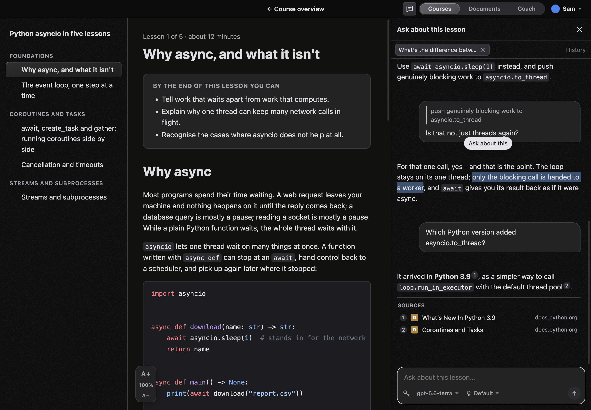
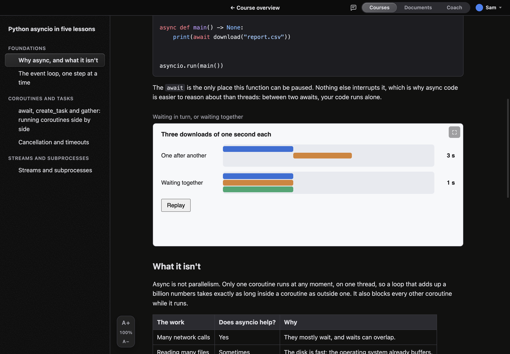
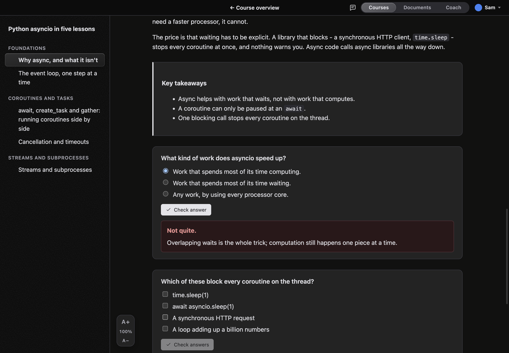
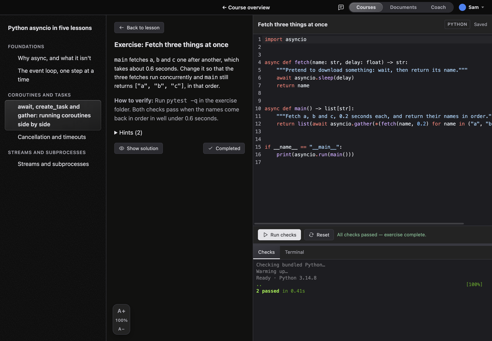
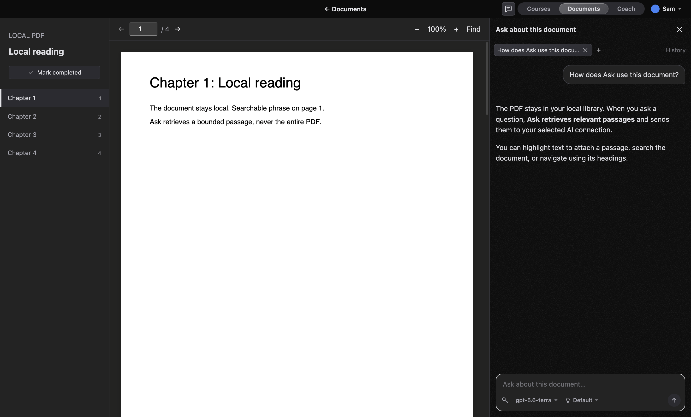
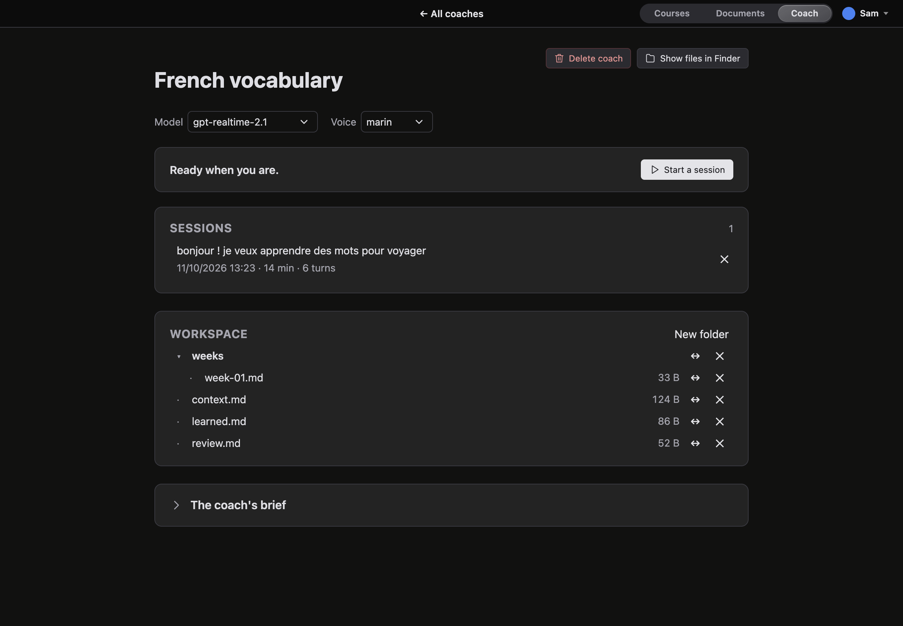
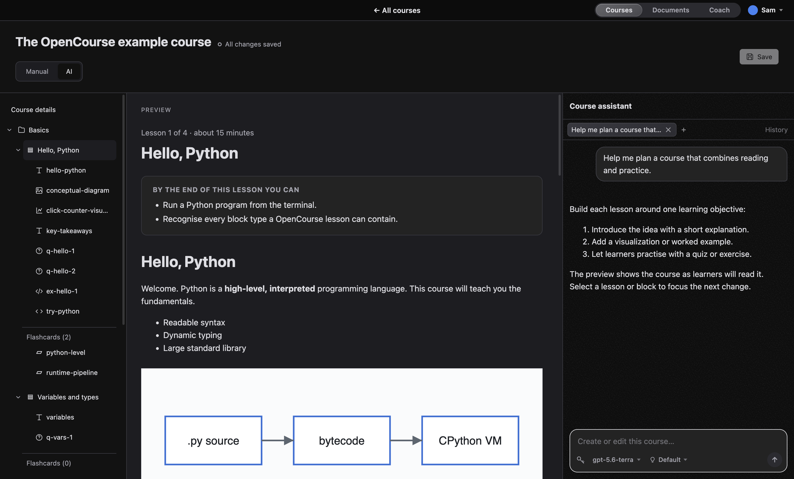
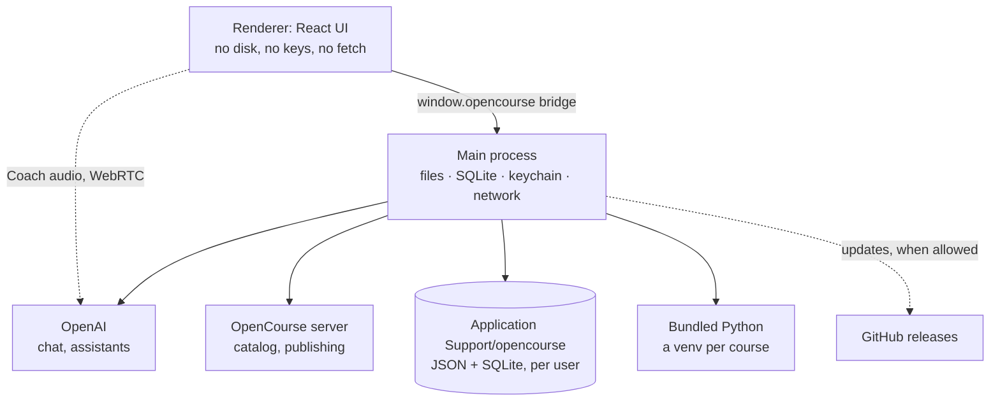
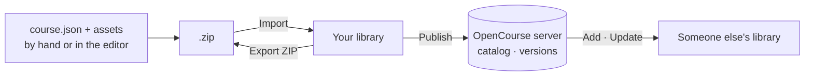

<p align="center">
  
</p>

<h1 align="center">OpenCourse</h1>

<p align="center">
  Courses on any subject, as a Mac app. Read, practise, ask, and share.<br>
  <a href="https://opencourse.dev"><b>opencourse.dev</b></a> ·
  <a href="https://catalog.opencourse.dev">Public catalog</a> ·
  <a href="docs/getting-started.md">Getting started</a> ·
  <a href="LICENSE">MIT</a>
</p>

<p align="center">
  
</p>

A course is a folder: a JSON manifest plus Markdown, images, video, sandboxed
interactive visualizations, quizzes and flashcards. Any course may also include
Python exercises that the app runs and grades on your Mac with the Python it
bundles. There is no account and no server to run. You import courses into a
local library, and progress stays on your Mac.

## What it does

- **Lessons that do things.** Visualizations run in a sandboxed frame, quizzes
  explain every answer, and flashcards come back on a spaced-repetition schedule.
- **Exercises that check themselves.** Open the editor and you get the brief, a real code
  editor, a terminal and **Run checks**. An exercise is complete when its checks
  pass. Python cells and a per-course notebook share the same bundled
  interpreter. Projects can use any language.
- **Ask about this.** Highlight a passage and ask the side chat about it. It
  knows the lesson you are on, and never sees quiz answers or solutions.
  **Documents** gives local PDFs the same chat.
- **Coach.** A spoken conversation with an OpenAI voice model about whatever you
  want to get better at. It keeps its own notes between sessions.
- **Write courses in the app.** A full course editor with a live preview, and an
  AI mode that drafts or revises the course for you. Nothing is written until
  you save.
- **Share them.** Connect to an [OpenCourse server](server/) to browse its
  catalog, add courses and get updates that keep your progress, or publish
  your own.
- **Themes.** Colours, fonts and pictures. A theme is values, never CSS
  ([format](docs/theme-format.md)).

The AI features use your own OpenAI API key or ChatGPT plan. The key stays in
the macOS keychain and only main sends it, to OpenAI.

<table>
  <tr>
    <td></td>
    <td></td>
    <td></td>
  </tr>
  <tr>
    <td align="center">Visualizations</td>
    <td align="center">Quizzes</td>
    <td align="center">Graded exercises</td>
  </tr>
  <tr>
    <td></td>
    <td></td>
    <td></td>
  </tr>
  <tr>
    <td align="center">Documents</td>
    <td align="center">Coach</td>
    <td align="center">AI course editor</td>
  </tr>
</table>

## How it's built

An Electron app in TypeScript and React. The window is split so that the
interface never touches the disk or a credential, and its only network traffic
is Coach's audio.



- **`app/src/core`** is pure TypeScript with no Electron in it, so it is unit-tested
  in isolation, and the server imports the same code to validate courses.
- **`app/src/main`** is the only code that touches the filesystem, the keychain or
  the network. The renderer's CSP is `connect-src 'self'`, so the interface
  cannot make a request on its own.
- **Storage**: atomic JSON for courses, progress and users, which a person can
  read and fix by hand. One SQLite file per user (`node:sqlite`) for chats and
  Coach transcripts, which grow without limit.
- **Course assets** are served over `opencourse://`, contained to their own course.

A course moves between people as a ZIP. It can come from a file someone sends
you, or from a server that versions it:



An update keeps the learner's progress on every lesson that still exists,
because a server course keeps the same IDs from one version to the next.

## Repository

| | |
| --- | --- |
| [`app/`](app/) | The Electron app: `src/core` (pure), `src/main` (Node/Electron), `src/renderer` (React) |
| [`server/`](server/) | The catalog server: Fastify, `node:sqlite`, archives on disk, and its React web app in `server/web/` |
| [`site/`](site/) | [opencourse.dev](https://opencourse.dev): Astro, static, with these `docs/` as its documentation |
| [`design/`](design/) | Tokens and primitives shared by the site and the server's web app |
| [`docs/`](docs/) | [Course format](docs/course-format.md), [theme format](docs/theme-format.md), [server API](docs/server-api.md), [self-hosting](docs/self-hosting.md) |

## Run it

Download the app from [opencourse.dev](https://opencourse.dev), or build it
from source with Node 22:

```bash
cd app
nvm use
npm install
npm run dev
```

The app ships no courses, so a dev build starts with an empty library.
**Help ▸ Get the course format** saves an example course you can import with
**Course ▸ Import Course** (⌘I). Tests,
the content gates, screenshots, the server, the website and releasing are
covered in [CONTRIBUTING.md](CONTRIBUTING.md).

## License

[MIT](LICENSE). The example theme's pictures and font are free to use, change
and share, as [its README](docs/example-theme/README.md) says.
