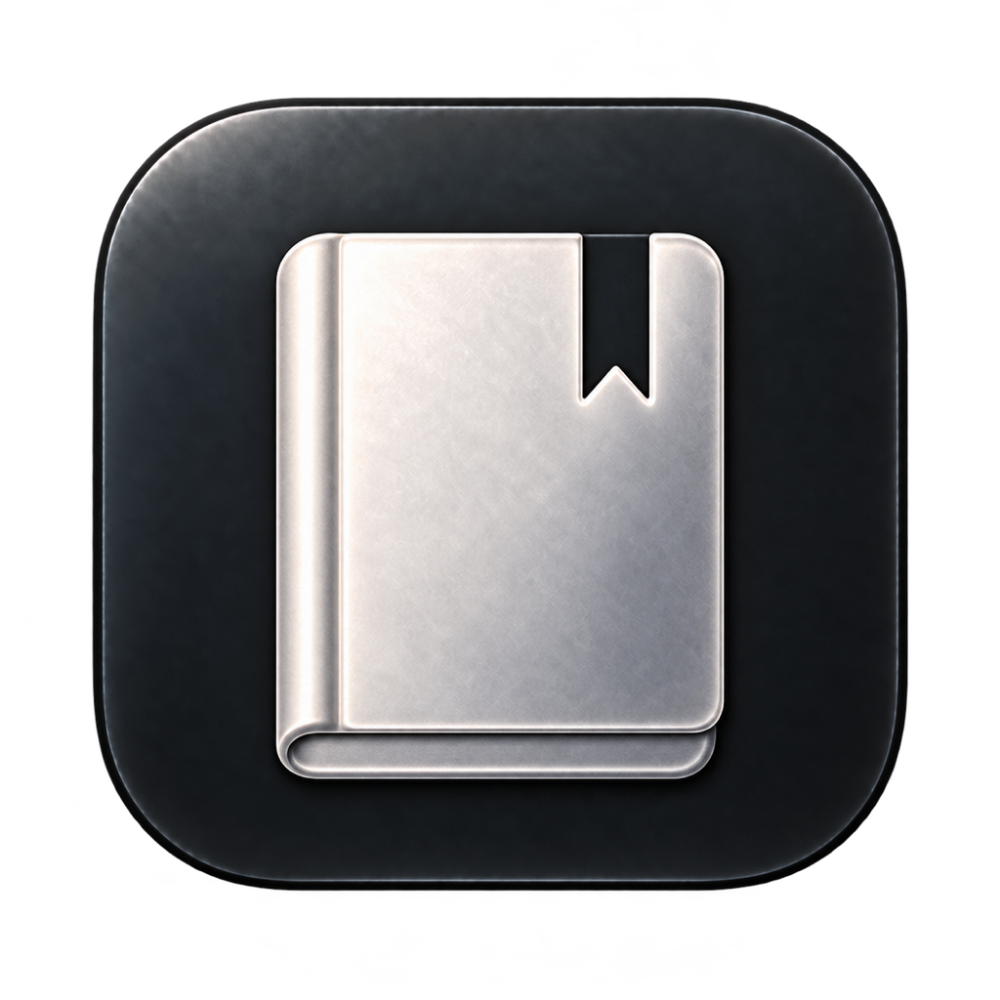
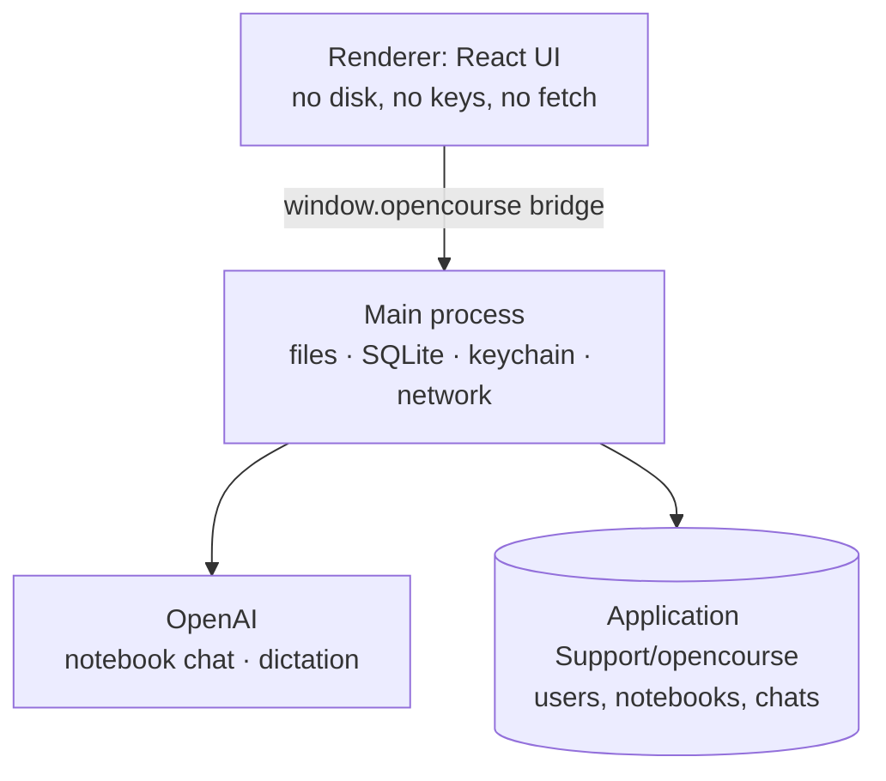

<p align="center">
  
</p>

<h1 align="center">OpenCourse Notebook</h1>

<p align="center">
  Personal notebooks on your Mac, shared with OpenCourse.<br>
  <a href="https://opencourse.dev"><b>opencourse.dev</b></a> ·
  <a href="LICENSE">MIT</a>
</p>

This app lives in the OpenCourse repository, in `notebook/`, and has its own
version. A notebook is a set of Markdown pages that belong to one local user.
This app opens the standalone notebooks OpenCourse already keeps: the ones that are not
tied to a course or a PDF. Create one here and it shows up in OpenCourse.
Open one there and it is the same notebook, with the same pages, images, and
chats. Course-linked and PDF-linked notebooks stay in OpenCourse. Python
notebooks, which run code inside a course, stay there too.

Both apps can be open at once. They share users, notebooks, chats, and the
AI connection in the macOS keychain. They do not upload notebooks to a server.

## What it does

- **Write in pages.** Each notebook opens with a page list and a live Markdown
  editor. Headings, lists, tables, and images format where you type. Pages save
  on their own. Rename a page in its title, add one from the sidebar, and
  reorder or delete pages from the page menu. The notebook menu switches
  notebooks and creates a new one.
- **Pictures and sketches.** Drop or paste PNG, JPEG, WebP, or GIF images and
  they are copied into the notebook. Press **⌘E** to insert a sketch. An empty
  line becomes the sketch; on a line with text, the sketch appears below it.
  Draw freehand, or choose a rectangle, circle, or arrow. With the eraser, drag
  across the marks you want to remove and release. Undo restores that gesture.
  Drag the bottom-right handle to make room, click away to see the image, and
  click it to edit again. **Escape** continues writing below. Change the
  shortcut and the default 450 × 300 px canvas in **Settings ▸ Appearance ▸
  Notebook sketches**.
- **Ask about this.** Highlight a passage and attach it to the notebook chat.
  The conversation continues when you change pages. The assistant can list,
  search, and read the notebook’s saved pages, including the one you just
  wrote, and it does not edit them. Dictate a message when a local AI
  connection is set up. If OpenCourse saved the same page while you were
  editing it, choose **Keep my edits** or **Reload saved page**.
- **Make it yours.** **View ▸ Theme** changes colours, fonts, and pictures.
  The page menu turns line numbers and wide text on or off, and the size
  control at the bottom of the page scales the writing and the chat. A
  Pomodoro timer sits in the title bar. **Settings** (⌘,) holds your name,
  themes, sketch defaults, the timer, and the AI connection.

Local AI uses the OpenAI API key or ChatGPT connection stored for OpenCourse
in the macOS keychain. Provider charges and plan limits apply. Chat sends the
notebook material needed for a reply to OpenAI and needs an internet connection.

## How it's built

An Electron app in TypeScript and React. The window never reads the disk or a
credential. Its content-security policy is `connect-src 'self'`, so the
interface cannot make a request of its own. Dictation audio uses WebRTC; the
OpenAI calls stay in the main process.



Notebooks, users, and chats live in OpenCourse’s data directory, so a backup
of that folder covers both apps. This app keeps its own Electron profile
(`opencourse-notebook`) for its window cache and single-instance lock, which
is why the two apps can run together. A development launch uses
`opencourse-dev` for the shared data and `opencourse-notebook-dev` for its
own profile, and it appears as **OpenCourse Notebook Dev**.

| | |
| --- | --- |
| [`src/core`](src/core) | Pure TypeScript: notebook model, Markdown, themes |
| [`src/main`](src/main) | The only code that touches files, the keychain, or the network |
| [`src/renderer`](src/renderer) | The React window |
| [`design`](design) | Shared visual assets |
| [`docs/default-theme`](docs/default-theme) | The Bond theme, as a portable copy of the default palette |

## Run it

On a Mac, with Node 22.13 or newer (Node 24 is fine):

```bash
npm install
npm run dev
```

Choose a local OpenCourse user, or create one. Notebooks you make here are
written to `~/Library/Application Support/opencourse/`, or to
`opencourse-dev` when you launched with `npm run dev`.

`npm test` runs the unit tests. `npm run typecheck` checks TypeScript.
`npm run dist` builds a macOS app bundle.

## License

[MIT](LICENSE).
